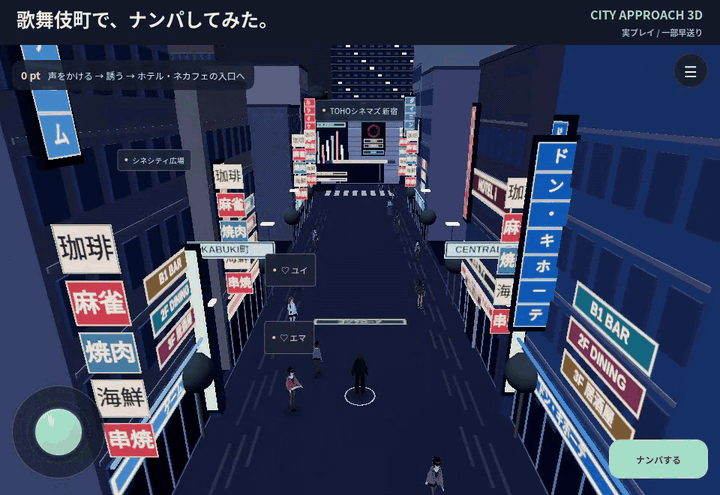

# CITY APPROACH 3D

**歌舞伎町で、ナンパしてみた。声掛けから、ふたりでゴールするまで。**

[](https://jim-auto.github.io/city_approach_3d/)

**[▶ 今すぐ遊ぶ](https://jim-auto.github.io/city_approach_3d/)** · [投稿用MP4](media/hero-gameplay.mp4?raw=true) · [GIFを開く](media/hero-gameplay.gif?raw=true)

実際のゲーム画面を録画したハイライトです。カット・一部早送りを含みます。スマホ・PCのブラウザで遊べます。

[city_approach](https://github.com/jim-auto/city_approach) の「相手のサインを観察 → 声かけ → 会話 → 同行」を、Three.jsの街で遊べるようにした3Dナンパシミュレーターです。女性キャラクターは全員20歳以上の架空の人物で、声掛け・会話・デートの誘い・同行までを遊べます。

## 公開版

**[スマートフォン・PCで遊ぶ](https://jim-auto.github.io/city_approach_3d/)**

GitHub Pagesで `main` ブランチの `docs/` を公開します。コードを更新したときは、`npm run build:pages` で配信用データを再生成し、`docs/` と一緒にコミット・pushしてください。`public/.nojekyll` はビルド時にコピーされます。

## 起動

Node.js 22.12以上を推奨します。

```bash
npm ci
npm run dev
```

表示されたローカルURLを開きます。既定では http://localhost:5173/ です。

## 遊び方

1. 「街へ出る」を押します。道を先に覚えるならメニューの「エリア・散策」からTOHOの周りを自動で一周できます。
2. 人、または頭上のサインをクリック／タップして観察します。遠い場合は自動で近くまで歩きます。
3. 行動サインに合う声かけを選びます。急いでいる・イヤホンに集中している相手は、会釈して離れると加点されます。
4. 会話はリアクションじゃんけん。相手が見せた手に勝つ手を、制限時間内にタップ（✊ボケる・✌ノる・✋聞く）。5回中3勝以上、好感度68以上・違和感60未満なら誘いへ進めます。連勝するとコンボ加点。PCは1・2・3でも操作できます。
5. 誘う場所を選び、相手の返事を確認します。歌舞伎町はカスタマカフェ・ホテルアイ、名古屋駅は同行練習としてタワーズ入口・金時計前・銀時計前。待ち合わせ中の相手はホテルを断るなど、予定によって返事が変わります。
6. 相手が了承した後に「一緒に向かう」を押すと同行開始。紫のマーカーまで歩くか目的地ボタンで自動移動します。建物を避ける道順で相手が歩いて追いかけ、離れた場合は自動移動を止めて待ちます。ふたりが選んだ施設の入口に到着するとGOAL CLEARです（名古屋駅は練習の到着ボーナス）。

歌舞伎町で誘いがOKになった相手と、ホテルアイかカスタマカフェの入口にふたりで到着するとGOAL CLEAR。会話・ミニゲームの点数だけではクリアになりません。名古屋駅は会話・同行の練習エリアです。最高スコアは、このブラウザに保存されます。スコアはエリアを切り替えても維持されます。

## 操作

| 操作 | 入力 |
| --- | --- |
| 移動 | WASD／矢印キー／地面をクリック |
| スマートフォンで移動 | 画面左下の丸いスティック／地面をタップ |
| アクション | 右側の「♫ アクション」から手を振る・会釈・ジャンプ・ダンスを選ぶ |
| PCのアクション | E：手を振る／B：会釈／Space：ジャンプ／Q：ダンス |
| 観察 | 人、頭上のサイン、スマホの「ナンパする」をクリック／タップ |
| 視点回転 | 街の画面をドラッグ |
| ズーム | マウスホイール／2本指ピンチ／メニューの＋− |
| 視点リセット | R／メニューの「視点を戻す」 |
| リアクションじゃんけん | 3つの手／数字キー1〜3 |
| 会話・パネルを閉じる | ×／Escape |
| 効果音 | メニューの♪で切替（初期状態はOFF） |

## シンプルな画面

常時表示はメニュー・移動スティック・「ナンパする」が中心です。相手を選んで「声をかける」を押すと会話が始まり、台詞を自分で選ぶ場合は「声のかけ方を選ぶ」を開きます。エリア切替・散策・ポーズはメニュー内です。地図、スコア、目標、ズーム・視点リセット、効果音と遊び方は右上のメニューにまとめています。メニュー表示中は移動を止め、閉じると探索・同行に戻ります。人物の頭上表示は9m以内の近い2人と選択中の相手に絞っています。

## スマートフォン向け調整

- 縦・横画面とノッチ／ホームインジケーターの余白に対応。
- 丸いスティックを360度に倒して移動。浅く倒すとゆっくり、深く倒すと速く歩き、指を離すと停止。
- 1本指ドラッグは視点回転、2本指はズーム。指を離した際の誤移動を防止。
- 観察中は操作ボタンをしまい、会話は3Dキャラを見ながら3つの手で操作。
- スマホでは描画解像度を抑え、毎秒30フレームを上限にし、動的な影と背景の通行人を削減。操作対象の人物は全員登場。
- 建物の描画をまとめ、アプリがバックグラウンドに移ると描画と長押し入力を停止。

実機での表示・発熱・バッテリー消費の計測は未実施です。

## 街のキャラクターと散策

歌舞伎町には居酒屋のキャッチとスカウトも登場します。近づくと声をかけられ、断る・話を聞く・道を尋ねるなどの返答を選べます。恋愛相手とは別の会話で、実店舗や実際の求人の案内は行いません。散策の自動移動中・デート同行中には割り込まず、会話を閉じると一定時間は再度声をかけません。

シネシティ広場の北寄りには、通称「トー横キッズ」をモチーフにした成人の架空の3人組（ソラ・ルカ・ネオ）を配置しています。音楽・服・写真の雑談や道案内を選べる街のNPCです。通り過ぎても会話は割り込まず、タップして話しかけます。メニューの「トー横の集まりへ歩く」で近くまで自動移動できます。

東宝ビル東側のゲーム独自区画「待ち合わせ通り」には、客待ち中のマイ（25歳）、P活女子のレイ（24歳）、ホストのカイト（27歳）を配置しています。各自の台詞・返答と服装を作り分け、会話画面には年齢も表示します。メニューの「立ちんぼ・P活・ホストの通りへ（架空）」で近くまで歩けます。この区画とホストクラブ「LUNA」はゲーム独自の設定です。

TOHOの正面→西側→裏側→東側→正面を歩ける歩道を追加し、開始画面とメニューに一周散策ボタンを置いています。スティックや移動キーを使うと自由移動へ切り替わります。ホテルなどで主人公が隠れる場合は、見通せる上方のカメラへ切り替えます。

## アクションコマンド

街歩き・同行中に、メニューの「視点・ポーズ」から主人公の動作を選べます。動作が終わると通常姿勢へ戻り、スティック・キー・地面タップで移動すると中断します。観察・会話・ヘルプ中は使用できません。スコアと会話判定には影響しません。

`node scripts/render-actions.mjs` で動作中のポーズ一覧を `artifacts/actions.svg` に書き出せます。

## 女の子とリズム遊び・特典

女の子をタップし、近づいて「一緒にリズム遊び · 15秒」を選びます。相手のジャンプ・手振り・ダンスを見て、バーが青い範囲に入ったら1回タップ。成功するとふたりが同じポーズをとり、相手が反応します。6つの合図でスターを獲得し、衣装・オーラを解放できます。PCはSpace/Enterでも操作できます。終了後の「この子と話す」から会話へ進めます。急いでいる相手や街の勧誘役は参加しません。

街の操作は丸い移動スティック・「近くの女の子」・メニューに集約。エリア切替・散策は「エリア・散策」、手動ポーズは「視点・ポーズ」、衣装は「特典・着せ替え」にまとめています。

成功数とPERFECT、コンボでスターを獲得します。成功1回でも最初の衣装に届きます。新しい特典は自動で装備し、メニューの「🎁 特典・着せ替え」で切り替えられます。

| 必要な累計スター | 特典 |
| --- | --- |
| 3 | ボルドージャケット |
| 8 | ミントオーラ |
| 16 | ホワイトジャケット |
| 26 | ゴールドオーラ |
| 40 | ストリートスターの称号 |

スター・ベスト記録・装備はブラウザのlocalStorageに保存します。スターを使っても減らない累計解放制です。途中終了では報酬を付与せず、同じ合図の連打・同じ結果の重複受取も防いでいます。バックグラウンドではタイマーを進めません。会話中・観察中・同行中は開始できません。通常のナンパ・会話・同行もそのまま遊べます。モデルの読込に失敗したときの軽量モデルでも衣装を反映します。

`node scripts/render-perks.mjs` で衣装とオーラのオフライン確認画像を `artifacts/perks.png` に出力できます。実機の画面・速度の検証とは異なります。

## 人物モデル

主人公、女性16人、街の人物8人、通行人を、完成済みのアニメ調VRMモデルに統一しています。ロングヘアの `VRM1_Constraint_Twist_Sample`、ボブの `AvatarSample_A`、リボン付きヘアの `AvatarSample_B`、男性の `AvatarSample_C` の4種類をベースに、髪色・服色・身長・表情・持ち物をキャラクターごとに設定しています。同じベースを使う人物の顔や服の基本形状は共通です。ユイの顔・髪・体の三角形は維持しています。

歩行・待機・瞬き、スマホ・本・コーヒー・カメラ・バッグ・メニュー・ヘッドホンなどの小物、眼鏡やネックレスに対応しています。主人公の手振り・会釈・ジャンプ・ダンスも新しい骨格で動作します。観察パネルはモデルごとの目の位置に合わせた顔アップです。

4つの元モデル合計約66.9MBを、テクスチャ縮小・同じ材質のパーツ統合・不要なバッファの削除・表情データの疎配列化などで約11.7MBに削減しています。A/B/Cは顔の三角形を保ち、体と髪の一部を軽量化しています。ユイの三角形は減らしていません。各人物を別ファイルでダウンロードする方式ではなく、4つのモデルを共有します。1体37,000三角形・26描画パーツ以内、女性16人と街の人物8人を配置し、スマホは選択中・同行中の相手を優先して近くの12人を描画。主人公と描画対象で最大負荷となる組み合わせが400,000三角形・320パーツ未満、通行人8人を含め550,000三角形・440パーツ未満に収まることをテストしています。背景人物は小さな持ち物を省略します。

形状・テクスチャ・同じ衣装の材質を共有し、表示用の骨格と表情は個別に複製します。表情データも必要な表情に統合し、輪郭用の追加描画と髪の物理演算は無効にしています。スマホでは、14mより遠い人物の姿勢を約8回/秒に抑え、移動と近くの人物は通常の更新を続けます。マップ切替や顔アップの生成後は、複製した骨格のGPU用データを解放します。モデルの読込に失敗すると再試行か従来の軽量モデルでの開始を選べます。

モデルはそれぞれの [VRM Public License 1.0](https://vrm.dev/en/licenses/1.0/)、[VRoidPreset A〜Zの利用条件](https://vroid.pixiv.help/hc/en-us/articles/4402394424089-VRoidPreset-A-Z)、埋め込みの利用設定に従って使用し、元の利用設定を保持しています。AvatarSample A/B/CはCC0ではありません。出典・変更内容・ハッシュは [public/models/LICENSE.txt](public/models/LICENSE.txt) と [scripts/avatar-sources.mjs](scripts/avatar-sources.mjs) にまとめ、ゲーム内メニューからも参照できます。ゲーム内の登場人物の名前・年齢・役割は架空です。

`npm run preview:cast` で同梱モデルを実際に読み込み、全員の全身・顔アップ・主人公のアクションを `artifacts/cast-{full,face,actions}.png` に書き出せます。`npm run preview:avatar` はユイ単体の確認用です。いずれもブラウザを操作しないオフライン描画で、実機WebGLの表示や速度の確認を代替しません。

元ファイルを `scripts/avatar-sources.mjs` に記載した名前で `artifacts/model-sources/` に保存して `npm run prepare:cast` を実行すると、配布用の4モデルを再生成できます。入力のSHA-256を照合してから処理します。`npm run prepare:avatar -- /path/to/VRM1_Constraint_Twist_Sample.vrm` ではユイだけを再生成できます。

`npm run preview:model` と `npm run preview:characters` は読込失敗時に使う従来のコード生成モデルの確認用です。ゲームの判定は行動サインだけで決まります。

## エリア

- **歌舞伎町／夜**：東宝ビル周辺を回れる街区。靖国通りからゴジラロードを北へ進むと東宝ビル正面、西の並行路が一番街、その西にシネシティ広場と東急歌舞伎町タワー、北側が花道通り。仲通り・東宝ビル前の通りを通って行き来できます。正面は大きな映画広告の区画、TOHO・IMAX看板、ホテルの横帯、ゴジラヘッドを造形。道路沿いに縦看板・袖看板を重ね、最初のカメラも街路を見通す角度に変更。
- **名古屋駅／昼**：屋内の中央コンコース。桜通口の金時計から、JR中央口・新幹線北口を経て、太閤通口の銀時計へつながる構成。金時計の複数の文字盤と細い柱、銀時計の青い文字盤と銀色の台座、タカシマヤ側の壁、エスカレーター、案内板、点字ブロックも造形。時計の台座は迂回して歩行。

[東急歌舞伎町タワー公式の周辺道路図](https://www.tokyu-kabukicho-tower.jp/assets/images/access/map_parking.png)、[新宿区の街区図（PDFの46ページ）](https://www.city.shinjuku.lg.jp/content/000417414.pdf)、[JR東海の名古屋駅構内図](https://railway.jr-central.co.jp/station-guide/shinkansen/nagoya/map.html)、[東宝の新宿東宝ビル施設資料](https://www.toho.co.jp/real-estate/kabukicho/)、[TOHOシネマズ新宿の施設案内](https://www.tohotheater.jp/theater/076/access.html)を参照しています。位置関係と目印をゲーム用の縮尺で組み、道路は方位を揃えて縮め、周辺店舗の間口・階数・看板は簡略化しています。映画広告の絵柄はオリジナルです。ゴール施設の内部は再現せず、入口で終了します。駅の屋根はプレイヤーが見えるよう梁を残した断面表示です。実寸・全店舗の完全再現ではありません。

`node scripts/render-district.mjs` で歌舞伎町の街路視点・俯瞰・道路図を `artifacts/district.svg` に出力できます（オフラインの形状プレビューで、実ブラウザの描画とは異なります）。

`node scripts/render-locations.mjs` で、ブラウザを操作せずに地形・建物のSVGを `artifacts/locations.svg` に書き出せます（看板のキャンバス文字テクスチャは省略）。登場人物の判定には外見ではなく行動サインを使います。

## 検証とビルド

```bash
npm test
npm run build
npm run preview
```

`dist/` が静的な配信用データです。Viteの相対ベースパスを設定しているため、GitHub Pagesのリポジトリ配下にも配置できます。HTMLを直接開くのではなく、HTTPサーバーから配信してください。

テストはTOHO外周一周とカメラの見通し、キャッチ・スカウトとの会話、チュートリアルからの開始、会話判定、両マップの3Dシーン構築・リソース解放、ランドマーク配置・時計を避ける経路探索、HTMLとアプリの状態遷移（観察→会話→同行→到着、遊び方からの復帰、エリア切替、会話の中断）を検証します。画面描画の目視検証は含みません。

## 構成

- `src/actions.js`：アクションコマンド・関節ポーズ
- `src/street-encounters.js`：キャッチ・スカウトの台詞と返答
- `src/camera.js`：建物で主人公が隠れないカメラの切り替え
- `src/characters.js`：人物の造形・共通リソース・関節アニメーション
- `src/locations.js`：名古屋駅構内の造形とマップ配置
- `src/kabukicho.js`：公式周辺図を参照した街区・道路網・周辺建物
- `src/toho.js`：新宿東宝ビルの正面・ホテル・ゴジラヘッド
- `src/encounters.js`：具体的な返答・目的地・誘いへの返事
- `src/navigation.js`：街路網・時計を避ける経路探索・移動範囲
- `src/scenery.js`：背景用の共通形状・材質・看板
- `src/authored-characters.js`：VRM読込・共有データ・骨格と表情の複製・歩行とアクション
- `src/cast.js`：全キャラクターのモデル・色・身長・小物
- `src/avatar-accessories.js`：持ち物・装飾と骨格への配置
- `public/models/`：同梱モデルと出典・利用条件
- `src/world.js`：Three.jsによる街・人物・移動・カメラ・ミニマップ
- `src/game.js`：プロフィール・声かけ・会話・スコア判定
- `src/app.js`：ゲーム進行とHTML操作
- `src/main.js`：起動
- `src/style.css`：画面・会話パネル・レスポンシブ表示

WebGL 2対応のブラウザが必要です。街はコードで生成し、人物には同梱のVRMモデルを使用します。モデルはGitHub Pages内から配信し、ゲーム起動時に外部モデルサービスへ接続しません。Webフォントが読み込めない場合は端末の標準フォントに切り替わります。

## 街の人通り

スマホは歌舞伎町に通行人16人、名古屋駅に12人（会話できる人物とは別）を配置。PCは32人・24人です。TOHO前・広場・裏通り・駅の両端に分散させ、通りを横切る動きも加えています。スマホは近くの通行人8人、PCは20人を優先描画し、画面外の人物も歩き続けます。通行人には軽い既存のVRMモデルを使い、メインキャラの品質を維持します。

## ナンパできる相手

女性キャラクターを8人から16人に増やしました。追加したエマ・カナ・ヒナ・ルナ・マナ・ノア・セナ・アヤは、全員20歳以上の架空の女性です。それぞれ映画・買い物・写真・ライブ・仕事帰り・道案内・カフェ探し・散歩の会話を持ち、声掛けから会話、リズム遊び、デートの提案、目的地までの同行ができます。入口は右下の「ナンパする」→ 相手の「声をかける」です。忙しい既存の3人には従来通り配慮し、参加できる相手は5人から13人になっています。

## ホテル・ネットカフェへの同行ゴール

歌舞伎町の誘い先をカスタマカフェ歌舞伎町店とHOTEL i（ホテルアイ）に変更しました。相手が行き先にOKしてから同行開始。プレイヤーが入口から1.4以内、相手が同じ入口から2.4以内に揃った時だけGOAL CLEARです。プレイヤーだけの到着や累計スコアではクリアできません。ホテルの誘いは好感度86以上・違和感30未満が必要で、待ち合わせ中のユイはホテルを断ります。カスタマカフェには通常の会話・誘い判定を使います。名古屋駅の時計・入口への同行は練習として区別します。

2026-11-08に以下の公式アクセス案内と、そのページからリンクされた地図を確認しました。

| 施設 | 確認した所在地 | ゲーム上の入口 |
| --- | --- | --- |
| [カスタマカフェ歌舞伎町店](https://rakutama.com/shop/kabukicho.html) | 歌舞伎町1-21-1 第二東亜会館ビル7F | TOHOの西側・一番街沿い。店舗フロアへ上がる前のビル1F入口 |
| [HOTEL i（ホテルアイ）](https://ssh-hotel-group.com/hotel_details/hotel-i/) | 歌舞伎町1-13-4 | TOHOの南東側・ゴジラロード沿いの入口 |

公式の地図リンク：[カスタマカフェ](https://goo.gl/maps/VKchcdvskwN2)、[HOTEL i](https://goo.gl/maps/eXUXAXonCdHUNpHi7)。地図のピン緯度経度・住所・ゲーム内座標は `src/venues.js` に保持。TOHOを基準にした東西・南北の関係を反映し、既存の圧縮した道路モデルの歩道へ入口を接続しています。実寸縮尺、建物の測量形状、正確な間口や階高、施設内部を再現したものではありません。画像や地図タイルはゲームに転載せず、看板・外観をコードで簡略化して描画します。

## デートスコア・同行中の遊び・ゴール記念写真

今回のデートごとにスコアを記録し、成功したデートの最高点を端末に保存します。メニューと街の表示は今回のスコア、ゴール画面はランクと各項目の内訳です。会話の中断や名古屋駅での同行練習ではゴール写真を解放しません。

| 項目 | 点数 |
| --- | --- |
| 声掛け成功 | 50 |
| 会話の正解 | 40 + 連続正解数 × 10（最大350） |
| 行き先への誘いがOK | 120 |
| 同行 | 近くで目的地へ進むと2点/m、合図への返事とコンボで加点（合計最大300） |
| ゴール到着 | 200 |
| テンポ | 100 − 同行秒数 ÷ 2（整数切り捨て・最低0） |

Sは1000点以上、Aは850点以上、Bは700点以上、Cはそれ未満。スコアの高さだけでゴールにはならず、引き続き相手と入口まで到着する必要があります。

同行中は相手と2.8以内で進むと歩調のスコアが増えます。目的地へ近づいた進捗に応じて最大4回の合図が出るので、5秒以内に右下ボタン（PCはF）で応えます。離れている場合は立ち止まって待ち、追いついた時に加点。合図を逃すとコンボが途切れます。足踏みや同じ場所の往復、ボタン連打では稼げず、同行ポイントは300で頭打ちです。メニューや別タブでは同行タイマーを停止します。

ゴールすると、相手の3Dモデルと現在のプレイヤーの衣装、同じ施設の外観を使ったツーショットを撮影します。キャラクターを撮影用に並べた720×480の記念写真で、イラスト生成や追加の画像ダウンロードは行いません。「記念写真を保存」から端末へダウンロードでき、メニューの「ゴール記念写真」からも見返せます。端末には最大16件を保存し、同じ相手・同じ施設種別の写真はより高いスコアの結果で更新します。保存容量が足りない場合は画面に案内し、その場の写真ダウンロードを利用できます。開発時の画像案は採用していません。

声掛けの窓は顔・名前・短い状況文と「声をかける」「離れる」が中心。「別の声かけ・一緒に遊ぶ」を開くと、台詞の選択とリズム遊びを使えます。

## ヒーローGIFの撮影・編集

`media/hero-gameplay.gif` と `media/hero-gameplay.mp4` は、独立した使い捨ての非表示ブラウザで実際のゲームを操作して録画したものです。ゲームの状態・点数・会話や結果を動画用に書き換えていません。字幕とカット・一部早送りだけを編集で加えています。録画中の進行・編集区間・結果は `media/hero-gameplay.json` に記録しています。

撮り直す場合は、`npm run build` の後、`npm run preview -- --host 127.0.0.1 --port 4188 --strictPort` で録画専用の静的サーバーを起動し、別のターミナルで以下を実行します（録画用にPlaywrightとそのブラウザ、編集用にFFmpeg、日本語フォントが必要）。普段のブラウザやプロファイルへの接続は行いません。

```bash
node scripts/record-hero.cjs
node scripts/edit-hero.cjs
```

`BASE_URL` でローカルURL、`PLAYWRIGHT_CHROMIUM_EXECUTABLE` で録画専用ブラウザの実行ファイル、`NODE_PATH` でPlaywrightの導入先、`HERO_FONT` で編集に使う日本語フォントを指定できます。元動画は無視対象の `artifacts/hero/` に保存し、README用GIF・投稿用MP4・共有プレビュー用JPEGだけを公開します。
